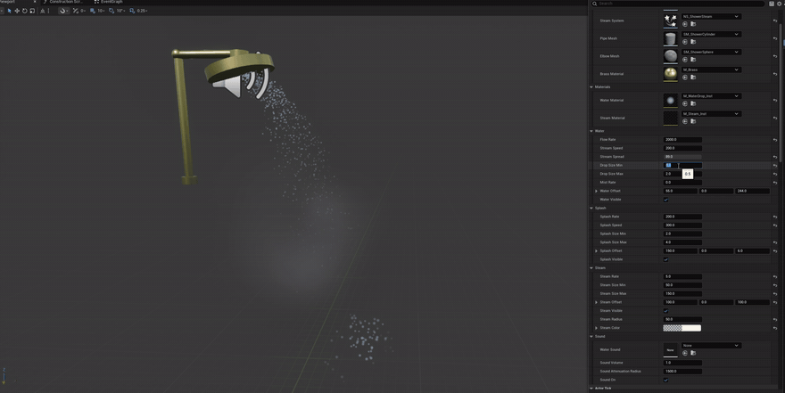

# Shower Niagara FX



---

## 🇷🇺 Русский

**Shower Niagara FX** — самодостаточный эффект душа для Unreal Engine 5.8: латунный душ из примитивов, круглые капли воды, брызги о пол, пар и зацикленный звук воды. Всё управляется из Details или прямо из блюпринта.

### Возможности

- 💧 Вода — круглые капли (Niagara), дуга струи + брызги у пола
- 🌫️ Пар и туман — отдельные системы с настройкой плотности, размера, радиуса, цвета и прозрачности
- 🔊 Зацикленный звук воды с громкостью и радиусом слышимости
- 🎛️ Материалы-инстансы: цвет и прозрачность воды/пара меняются в один клик
- 🧩 C++ актор `ShowerActor` + блюпринт-наследник `BP_Shower` с нодами, ивентами и диспатчерами
- 📦 Самодостаточен: свои меши, материалы, звук; из движка нужен только плагин Niagara

### Установка

1. Скопируйте папку `Plugins/ShowerFX` в папку `Plugins/` вашего проекта.
2. Скопируйте папку `Content/VFX/Shower` (и при желании демо-уровень `Content/VFX/L_ShowerDemo.umap`) в `Content/` вашего проекта.
3. Перезапустите редактор и согласитесь включить плагин **ShowerFX** (или включите вручную: Edit → Plugins → ShowerFX).
4. Перетащите `BP_Shower` из `Content/VFX/Shower` в свой уровень.

> Демо-уровень `L_ShowerDemo` показывает душ в «комнате» из плитки — можно использовать как референс освещения и расстановки.

### Быстрая настройка (Details актора)

| Группа | Параметры |
|---|---|
| **Water** | Flow Rate (плотность струи), Stream Speed, Stream Spread (разлёт), Drop Size Min/Max, Mist Rate, Water Offset, Water Visible |
| **Splash** | Splash Rate, Splash Speed, Splash Size Min/Max, Splash Offset, Splash Visible |
| **Steam** | Steam Rate, Steam Radius, Steam Size Min/Max, Steam Color (альфа = прозрачность), Steam Offset, Steam Visible |
| **Sound** | Water Sound, Sound Volume, Sound Attenuation Radius (радиус слышимости), Sound On |
| **Materials** | Water Material, Steam Material — любые материалы/инстансы |
| **Assets** | Системы Niagara, меши трубы и лейки, латунный материал |

### Управление из блюпринта

На `BP_Shower` доступны ноды (категория **ShowerFX**):

- `Start Shower` / `Stop Shower` — включить/выключить всё разом
- `Set Water Visible`, `Set Splash Visible`, `Set Steam Visible` — показать/скрыть часть эффекта
- `Set Sound On` — звук
- `Set Flow Rate`, `Set Steam Rate` — плотность на лету

Диспетчеры (Event Dispatchers): `On Water Changed`, `On Splash Changed`, `On Steam Changed`, `On Sound Changed` — сообщают миру о переключениях.

Ивенты для реализации графиком в `BP_Shower`: `Event On Shower Started`, `Event On Shower Stopped`.

Пример: мировое событие → ссылка на `BP_Shower` → `Start Shower` → душ включился, а подписчики `On Water Changed` получили `true`.

### Состав

```
Content/VFX/Shower/       BP_Shower, системы Niagara (NS_ShowerWater/Splash/Steam),
                          материалы (M_Brass, M_WaterDrop[+Inst], M_Steam[+Inst],
                          M_TileWall, M_FloorStone), меши, звук
Content/VFX/              L_ShowerDemo — демо-уровень
Plugins/ShowerFX/         C++ плагин (актор ShowerActor + редакторская утилита)
Media/                    GIF-превью
```

### Требования

- Unreal Engine **5.8** (на других версиях не проверялся)
- Плагин **Niagara** (включён по умолчанию)
- Для использования C++ актора — сборка проекта из исходников (Visual Studio 2022). Если C++ не нужен, можно пользоваться системами Niagara `NS_*` напрямую.

### Примечание о звуке

`S_WaterLoop` — копия лупа из набора **MedFantasy SFX Bundle**, импортированного в проект-источник. Перед публикацией своих проектов проверьте лицензию этого набора или замените звук на собственный (поле `Water Sound`).

---

## 🇬🇧 English

**Shower Niagara FX** is a self-contained shower effect for Unreal Engine 5.8: a brass shower built from primitives, round water droplets, floor splash, steam and a looping water sound. Everything is tweakable from the Details panel or directly from Blueprint.

### Features

- 💧 Water — round Niagara droplets, arcing stream + floor splash
- 🌫️ Steam & mist — separate systems with density, size, radius, color and opacity controls
- 🔊 Looping water sound with volume and audible radius
- 🎛️ Material instances: water/steam color and opacity in one click
- 🧩 C++ `ShowerActor` + `BP_Shower` Blueprint child with functions, events and dispatchers
- 📦 Self-contained: custom meshes, materials and sound; only the stock Niagara plugin is required

### Installation

1. Copy `Plugins/ShowerFX` into your project's `Plugins/` folder.
2. Copy `Content/VFX/Shower` (and optionally the demo level `Content/VFX/L_ShowerDemo.umap`) into your project's `Content/` folder.
3. Restart the editor and accept the **ShowerFX** plugin prompt (or enable it manually: Edit → Plugins → ShowerFX).
4. Drag `BP_Shower` from `Content/VFX/Shower` into your level.

> The `L_ShowerDemo` level shows the shower inside a tiled "room" — use it as a lighting/layout reference.

### Quick tuning (actor Details)

| Group | Parameters |
|---|---|
| **Water** | Flow Rate, Stream Speed, Stream Spread, Drop Size Min/Max, Mist Rate, Water Offset, Water Visible |
| **Splash** | Splash Rate, Splash Speed, Splash Size Min/Max, Splash Offset, Splash Visible |
| **Steam** | Steam Rate, Steam Radius, Steam Size Min/Max, Steam Color (alpha = opacity), Steam Offset, Steam Visible |
| **Sound** | Water Sound, Sound Volume, Sound Attenuation Radius, Sound On |
| **Materials** | Water Material, Steam Material — any material or instance |
| **Assets** | Niagara systems, pipe/head meshes, brass material |

### Blueprint control

`BP_Shower` exposes these nodes (category **ShowerFX**):

- `Start Shower` / `Stop Shower` — toggle everything at once
- `Set Water Visible`, `Set Splash Visible`, `Set Steam Visible` — show/hide parts
- `Set Sound On` — sound
- `Set Flow Rate`, `Set Steam Rate` — live density

Event Dispatchers: `On Water Changed`, `On Splash Changed`, `On Steam Changed`, `On Sound Changed` — broadcast the current state.

Blueprint-implementable events on `BP_Shower`: `Event On Shower Started`, `Event On Shower Stopped`.

Example: a world event → `BP_Shower` reference → `Start Shower` → the shower turns on and every `On Water Changed` subscriber receives `true`.

### Layout

```
Content/VFX/Shower/       BP_Shower, Niagara systems (NS_ShowerWater/Splash/Steam),
                          materials (M_Brass, M_WaterDrop[+Inst], M_Steam[+Inst],
                          M_TileWall, M_FloorStone), meshes, sound
Content/VFX/              L_ShowerDemo — demo level
Plugins/ShowerFX/         C++ plugin (ShowerActor + editor utility module)
Media/                    GIF preview
```

### Requirements

- Unreal Engine **5.8** (untested on other versions)
- **Niagara** plugin (enabled by default)
- Using the C++ actor requires building the project from source (Visual Studio 2022). If you don't need C++, drive the `NS_*` Niagara systems directly.

### Sound note

`S_WaterLoop` is a copy of a loop from the **MedFantasy SFX Bundle** imported into the source project. Check that bundle's license before redistributing, or replace the sound with your own via the `Water Sound` field.

---

## License / Лицензия

MIT — see [LICENSE](LICENSE).
